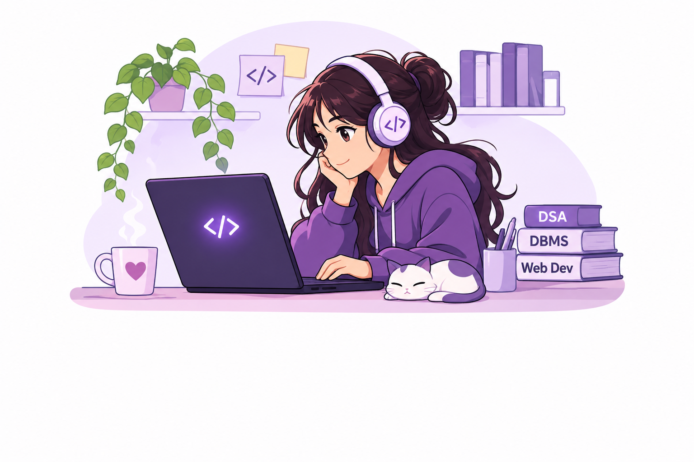

<!-- ✨ DIVYA MER | CYBERPUNK PROFILE -->

  ---

 

  

  <i>Curious mind. Creative ideas. Endless lines of code.</i>

---

### `> Hello, World!` 👾

**BCA Student • Aspiring Software Developer • Open Source Learner**

*Learning by building. Growing through mistakes. Improving one commit at a time.*

[GitHub](https://github.com/Codectrix-0) • [LinkedIn](https://www.linkedin.com/in/divyamer/) • [Portfolio](https://portfolio-website-six-alpha-86.vercel.app/)

---

---

<h2 align="center">✦ A LITTLE ABOUT ME ✦</h2>

  Hey! I'm Divya, a BCA student who enjoys exploring technology,
  solving problems, and learning how software works.

  🌱 Currently exploring Data Structures & Algorithms 
  💻 Learning web development and software development 
  🌍 Interested in Open Source Contributions 
  🎯 Working towards becoming a better problem solver 
  ✨ Learning something new with every commit

---

<h2 align="center">⚡ TECH STACK & TOOLS</h2>

<h3 align="center">Languages</h3>

  

<h3 align="center">Web Development</h3>

  

<h3 align="center">Tools & Platforms</h3>

  

---

<h2 align="center">📚 CURRENT LEARNING JOURNEY</h2>

  
  
  

---

<h2 align="center">📊 GITHUB STATISTICS</h2>

  
  

  

---

<h2 align="center">📈 CONTRIBUTION GRAPH</h2>

  

---

<h2 align="center">🎓 MY JOURNEY</h2>

  🎓 BCA Student (2025 – 2028) 
  💻 Started exploring programming and development 
  🌱 Growing through hands-on learning 
  🌍 Exploring the open-source community 
  🚀 Building skills one step at a time

---

<h2 align="center">💭 MY DEVELOPER PHILOSOPHY</h2>

  <b>Understand the problem → Write the logic → Code → Test → Learn.</b>

  <i>"Every expert was once a beginner who refused to give up."</i>

  

---

<h2 align="center">🤝 LET'S CONNECT</h2>

  
  
  

  <b>Thanks for visiting my corner of GitHub! 💜</b>

  <i>Made with curiosity, coffee & lots of debugging.</i>

